# 📚 Book Tracker: an end-to-end DevSecOps capstone

A small full-stack app for tracking the books you want to read, are reading, or have finished, shipped with a
production-style DevOps toolchain around it. It includes automated tests, container images, a CI/CD pipeline with a
security gate, AWS infrastructure as code, Kubernetes with Helm and GitOps, and Prometheus/Grafana observability.

The application is deliberately small. The point of the project is everything **around** the code: how a commit
becomes a tested, scanned, versioned image running on a Kubernetes cluster that is provisioned from code and
monitored live.

| | |
|---|---|
| **Repository** | https://github.com/vanditabyaa09/book-tracker-devops |
| **Container images** | `ghcr.io/vanditabyaa09/book-tracker-backend`, `ghcr.io/vanditabyaa09/book-tracker-frontend` (tagged by Git commit SHA) |
| **Cloud** | AWS `ap-south-1` (Mumbai): VPC + EKS 1.36 |
| **Demo video and slides** | [`demo/`](demo/) |

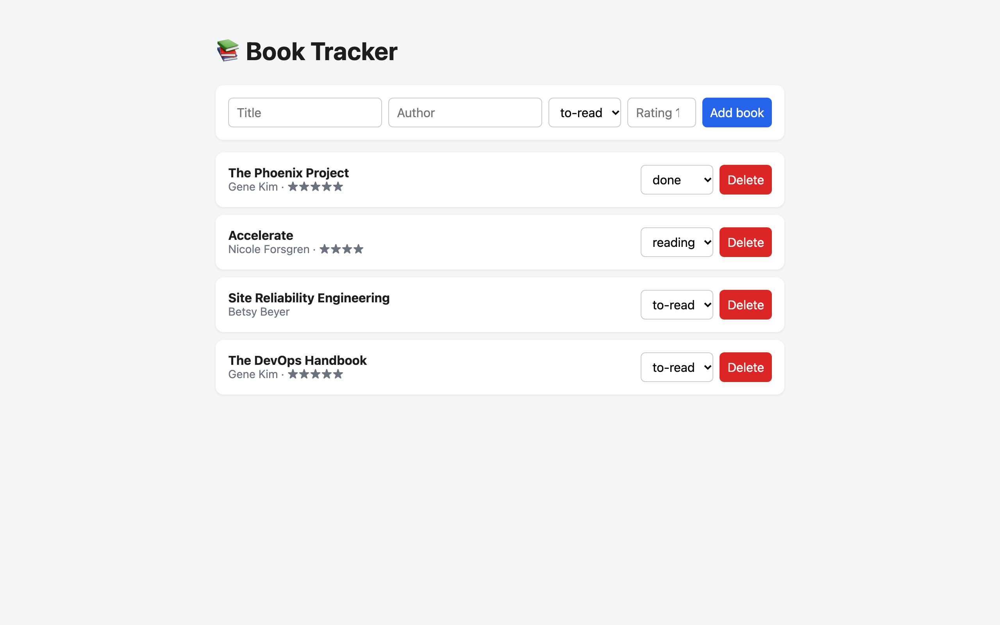

---

## Contents
1. [Architecture](#1-architecture)
2. [Tech stack](#2-tech-stack)
3. [Repository layout](#3-repository-layout)
4. [Application and API](#4-application-and-api)
5. [Local setup (Docker Compose)](#5-local-setup-docker-compose)
6. [Testing and code quality](#6-testing-and-code-quality)
7. [CI/CD pipeline](#7-cicd-pipeline-github-actions)
8. [DevSecOps: Trivy image scanning](#8-devsecops-trivy-image-scanning)
9. [Infrastructure as Code: Terraform (AWS VPC + EKS)](#9-infrastructure-as-code-terraform-aws-vpc--eks)
10. [Kubernetes and Helm deployment](#10-kubernetes--helm-deployment)
11. [GitOps with ArgoCD](#11-gitops-with-argocd)
12. [Observability: Prometheus and Grafana](#12-observability-prometheus--grafana)
13. [Teardown and cost control](#13-teardown-and-cost-control)
14. [Known issues and limitations](#14-known-issues-and-limitations)
15. [Screenshot index](#15-screenshot-index)

---

## 1. Architecture

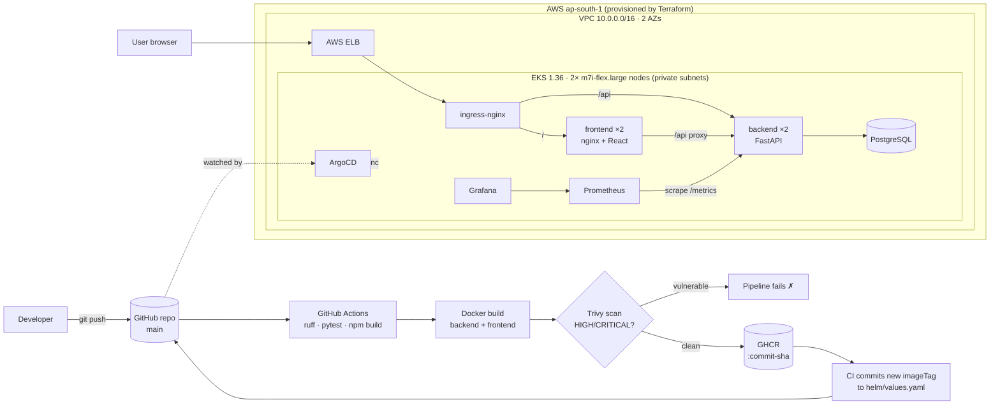

**How a request flows:** browser → AWS load balancer (created by the ingress-nginx `LoadBalancer` Service in the public
subnets) → **Ingress** rule. `/api/*` goes to the `backend` Service (FastAPI, 2 replicas); everything else goes to the
`frontend` Service (nginx serving the React build, 2 replicas). The backend talks to PostgreSQL through the `postgres`
ClusterIP Service.

**How a change ships:** push to `main` → lint + tests + frontend build → Docker images built → **Trivy gate** → images
pushed to GHCR tagged with the commit SHA → CI commits that SHA into `helm/book-tracker/values.yaml` → **ArgoCD**
detects the Git change and rolls the cluster forward.

## 2. Tech stack

| Layer | Technology |
|---|---|
| Backend | Python 3.13, **FastAPI**, SQLAlchemy 2, Pydantic v2, Uvicorn |
| Database | **PostgreSQL 17**, **Alembic** migrations |
| Frontend | **React 19** + Vite 8, served by **nginx** (unprivileged image) |
| Testing / quality | **pytest** (+ FastAPI TestClient, isolated SQLite DB), **ruff** linter |
| Containers | **Docker** (non-root, multi-stage frontend), **Docker Compose** |
| CI/CD | **GitHub Actions**, **GitHub Container Registry (GHCR)** |
| Security | **Trivy** image scanning, SHA-pinned third-party actions, non-root containers |
| IaC | **Terraform** 1.16 + `terraform-aws-modules/vpc` and `/eks` |
| Cloud | **AWS**: VPC, subnets, NAT gateway, IAM, **EKS**, managed node group, ELB |
| Orchestration | **Kubernetes** 1.36, **Helm** chart, **ingress-nginx** |
| GitOps | **ArgoCD** |
| Observability | **Prometheus** (kube-prometheus-stack, ServiceMonitor), **Grafana** |

## 3. Repository layout

```
.
├── backend/                  FastAPI service
│   ├── app/                  main.py · database.py · models.py · schemas.py · routes.py
│   ├── alembic/versions/     database migrations
│   ├── tests/                pytest suite (conftest.py + test_books.py)
│   ├── Dockerfile            non-root runtime image (uid 10001)
│   ├── pytest.ini · pyproject.toml (ruff config)
│   └── requirements.txt · requirements-dev.txt
├── frontend/                 React + Vite app
│   ├── src/App.jsx           UI calling the REST API
│   ├── nginx.conf            serves the SPA, proxies /api → backend
│   └── Dockerfile            multi-stage: node build → nginx-unprivileged (uid 101)
├── docker-compose.yml        postgres + backend + frontend
├── .github/workflows/ci.yml  CI/CD pipeline
├── terraform/                VPC + EKS (versions, variables, vpc, eks, outputs, tfvars.example)
├── k8s/                      namespace.yaml · argocd-application.yaml
├── helm/book-tracker/        Chart.yaml · values.yaml · templates/
├── monitoring/               Prometheus + Grafana Helm values, Grafana dashboard JSON
├── docs/screenshots/         evidence screenshots used in this README
└── demo/                     presentation video + slides
```

## 4. Application and API

Each book has a `title`, `author`, `status` (`to-read` | `reading` | `done`) and an optional `rating` (1–5).
Validation is done by Pydantic, so bad input returns **422** automatically.

| Method | Path | Description | Success |
|---|---|---|---|
| `GET` | `/health` | Liveness/readiness probe (no DB call) | 200 |
| `GET` | `/metrics` | Prometheus metrics (prometheus-fastapi-instrumentator) | 200 |
| `GET` | `/api/books` | List all books | 200 |
| `GET` | `/api/books/{id}` | Get one book | 200 / 404 |
| `POST` | `/api/books` | Create a book | 201 / 422 |
| `PUT` | `/api/books/{id}` | Replace a book | 200 / 404 / 422 |
| `DELETE` | `/api/books/{id}` | Delete a book | 204 / 404 |

Interactive API docs: `http://localhost:8000/docs` when running locally.

**Design decisions**
- **All API routes live under `/api`**, so one Ingress can route by path prefix with no URL rewriting.
- **The frontend only ever calls relative URLs** (`/api/books`). In development the Vite dev server proxies them, in Docker
  nginx proxies them, and in Kubernetes the Ingress routes them. There is no CORS setup and no hard-coded hostnames.
- **Configuration comes from environment variables** (`DATABASE_URL`, 12-factor style). The same image runs in Compose,
  CI and Kubernetes.
- **The schema is managed by Alembic**. The container runs `alembic upgrade head` before starting Uvicorn, so the schema is
  always current.

The UI is responsive. It stacks into a single column on phones:

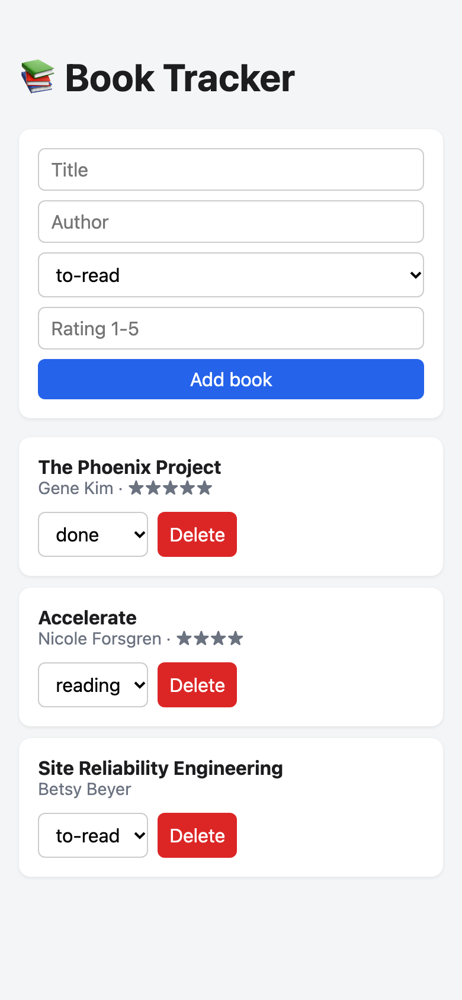

## 5. Local setup (Docker Compose)

**Prerequisites:** Docker Desktop (≥ 6 GB RAM recommended), Git.

```bash
git clone https://github.com/vanditabyaa09/book-tracker-devops.git
cd book-tracker-devops
docker compose up --build
```

| URL | What |
|---|---|
| http://localhost:3000 | React app (nginx), which proxies `/api` to the backend |
| http://localhost:8000/docs | FastAPI Swagger UI |
| http://localhost:8000/metrics | Prometheus metrics |
| `localhost:5433` | PostgreSQL (user/pass/db: `books`). Port 5433 on the host avoids clashing with a local Postgres on 5432 |

The `postgres` service has a `pg_isready` healthcheck, and the backend uses `depends_on: condition: service_healthy`, so
migrations only run once the database accepts connections.

**Running without Docker (development):**
```bash
docker compose up -d postgres
cd backend && python3 -m venv .venv && source .venv/bin/activate
pip install -r requirements-dev.txt
alembic upgrade head
uvicorn app.main:app --reload          # http://localhost:8000
cd ../frontend && npm install && npm run dev   # http://localhost:5173
```

| `docker compose up --build` | App on `localhost:3000` |
|---|---|
| 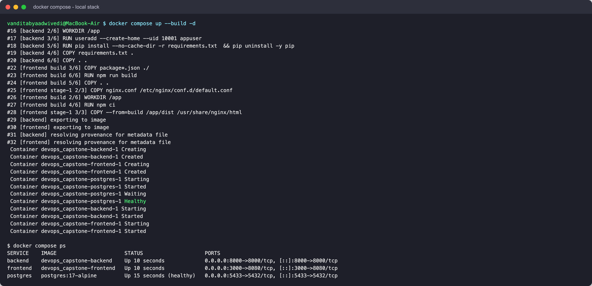 | 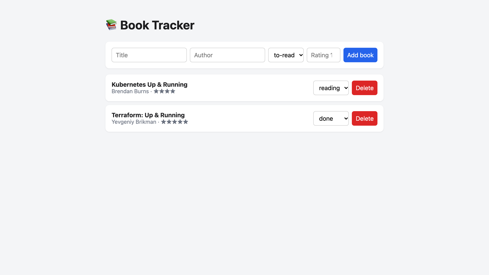 |

**Both images run as non-root users:** the backend as uid `10001`, the frontend as uid `101`.

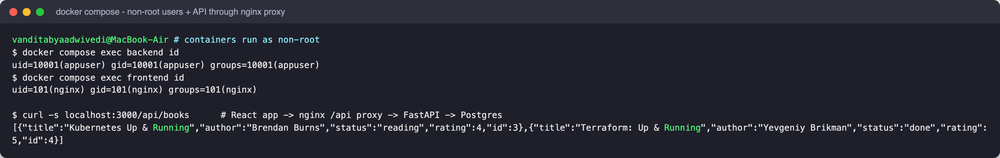

**Image design**
- **Backend:** `python:3.13-slim`, with dependencies installed before the source is copied (layer caching). **pip is
  uninstalled after installing dependencies**, so the runtime image carries no package manager (see §8). It runs as
  numeric `USER 10001`, which lets Kubernetes `runAsNonRoot` verify it.
- **Frontend:** a **multi-stage build**. Stage 1 (`node:24-alpine`) runs `npm ci && npm run build`. Stage 2
  (`nginxinc/nginx-unprivileged:alpine`) contains only the static files and nginx, and listens on 8080 as uid 101.
  Node and `node_modules` never reach production.

## 6. Testing and code quality

```bash
cd backend
pytest -v        # 8 tests
ruff check .     # lint (generated alembic/ code is excluded in pyproject.toml)
```

- **8 test cases** cover `/health`, `/metrics`, and every CRUD endpoint (list, get, create, update, delete), including
  the 404 and 422 error paths.
- **The tests never touch the real database.** `tests/conftest.py` creates an in-memory SQLite engine
  (`StaticPool`) and swaps it in through FastAPI's `app.dependency_overrides[get_db]`. Each test gets fresh tables, so
  tests are isolated and CI needs no Postgres service.
- `pytest.ini` sets `testpaths`, `pythonpath` and verbose output.

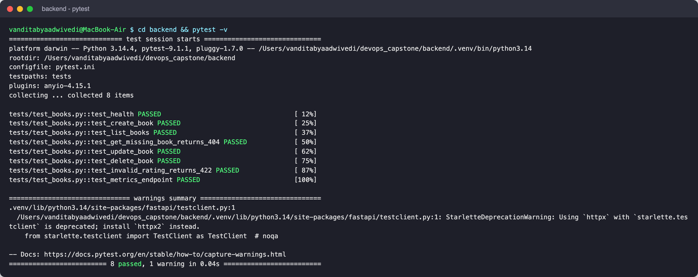

## 7. CI/CD pipeline (GitHub Actions)

The workflow lives in [`.github/workflows/ci.yml`](.github/workflows/ci.yml). It runs on every **push to `main`** and on
pull requests (PRs run tests and build only, with no image push).

```
push to main ─┬─► test-backend    pip install → ruff check → pytest -v
              └─► build-frontend  npm ci → npm run build
                         │ (both must pass: `needs:`)
                         ▼
              docker  [matrix: backend, frontend]
                 build image (load locally)
                 → Trivy scan, exit-code 1 on HIGH/CRITICAL
                 → docker push ghcr.io/vanditabyaa09/book-tracker-<component>:<git-sha>
                         │
                         ▼
              update-helm-values
                 sed imageTag → <git-sha> in helm/book-tracker/values.yaml
                 commit "ci: deploy images <sha> [skip ci]" → ArgoCD picks it up
```

| Requirement | How it is met |
|---|---|
| Fails on test failure | `docker` has `needs: [test-backend, build-frontend]`. A failing ruff/pytest step stops the pipeline before any image is built |
| Frontend built in CI | `build-frontend` job runs `npm ci && npm run build` |
| Images for both services | `strategy.matrix.component: [backend, frontend]` |
| Pushed to GHCR | `docker/login-action` with the built-in `GITHUB_TOKEN` and `permissions: packages: write`. No personal tokens are stored |
| SHA tags, not `latest` | Tag is `${{ github.sha }}`, so every image maps to exactly one commit, which gives traceable, immutable, easy rollbacks |
| No infinite loop | The bot commit carries `[skip ci]`, and pushes made with `GITHUB_TOKEN` don't re-trigger workflows |

**A green end-to-end run:** [Actions run #5](https://github.com/vanditabyaa09/book-tracker-devops/actions/runs/38906757609)

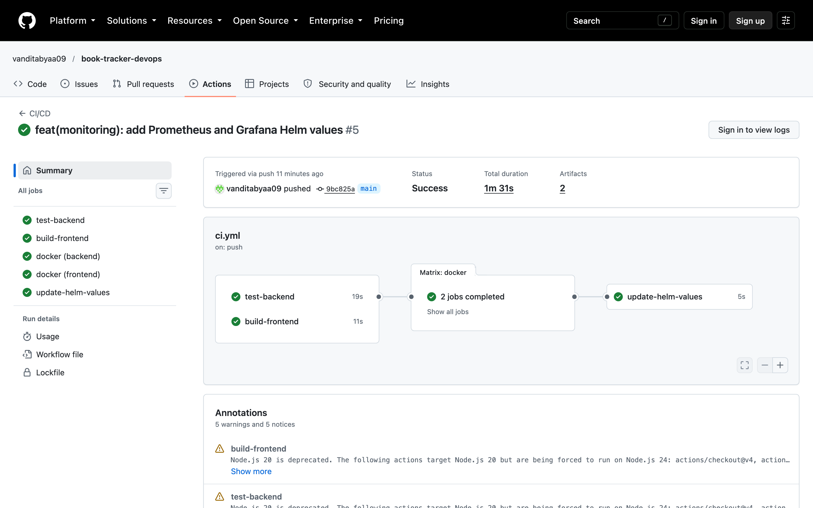

**Published images on GHCR (public, SHA-tagged):**

| Backend | Frontend |
|---|---|
| 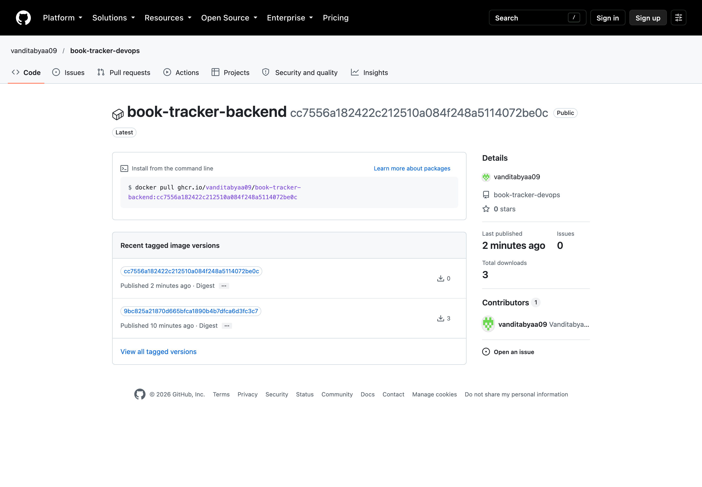 | 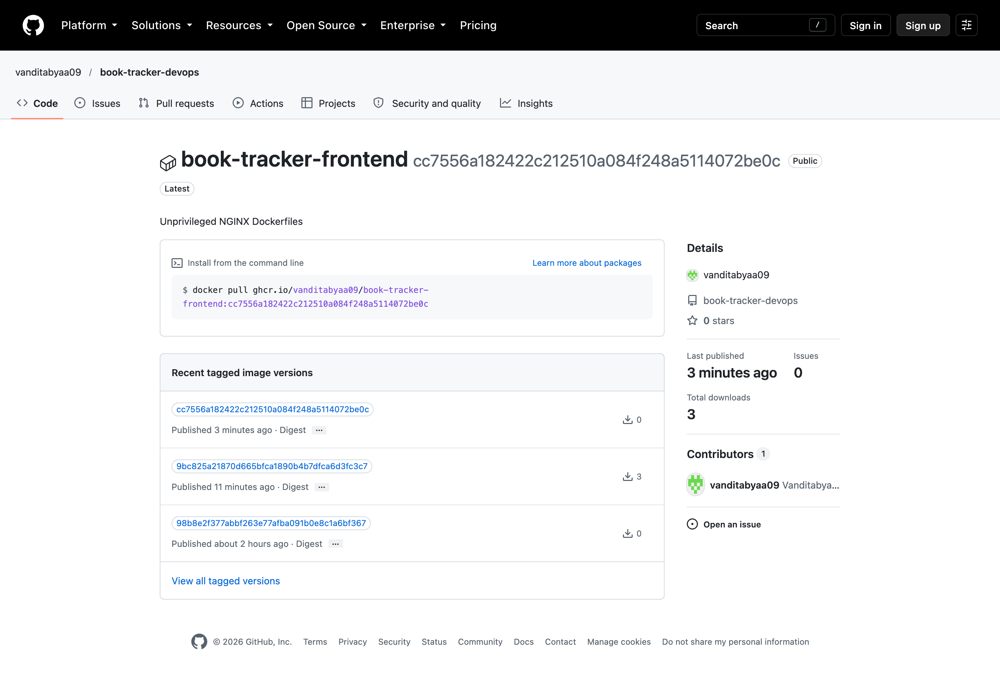 |

## 8. DevSecOps: Trivy image scanning

Each image is scanned **after it is built and before it is pushed**. A vulnerable image never reaches the registry.

```yaml
- uses: aquasecurity/trivy-action@ed142fd0673e97e23eac54620cfb913e5ce36c25 # v0.36.0
  with:
    image-ref: ghcr.io/vanditabyaa09/book-tracker-<component>:<sha>
    severity: HIGH,CRITICAL
    exit-code: "1"          # fail the job on any HIGH/CRITICAL finding
    ignore-unfixed: true    # only fail on CVEs that have an available fix
```

**Why the action is pinned to a commit SHA rather than a tag:** Git tags are mutable. In March 2026 attackers
force-pushed malicious code to `trivy-action` release tags, so every pipeline that referenced `@master` or a version
tag executed the attacker's code with access to its secrets. A full commit SHA is immutable. We pinned v0.36.0, a
GitHub-verified commit released after the incident.

### What the scan found, and how it was fixed

Trivy scans both the **OS packages** of the base image (Debian 13 for the backend, Alpine 3.24 for the frontend) and
the **language packages** inside the image (Python dist-info metadata, vendored dependency manifests).

The first scan of the backend **failed with 4 HIGH vulnerabilities**: `CVE-2025-47273` (setuptools path traversal),
`CVE-2026-97687` and `CVE-2026-97689` (urllib3 TLS interception and DoS), and `GHSA-6v7p-g79w-8964` (msgpack
out-of-bounds read).

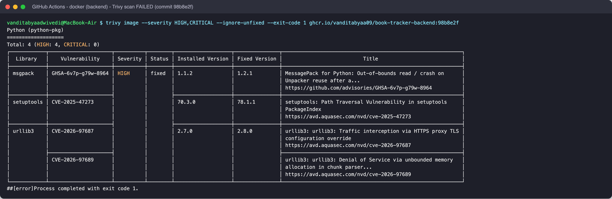

**Root cause:** none of these were our dependencies. They were **copies vendored inside pip itself**
(`pip/_vendor/vendor.txt` lists `setuptools==70.3.0`, `msgpack==1.1.2`, `urllib3`), which ships in the
`python:3.13-slim` base image. Our app can't even import `urllib3`.

**Fix:** pip is only needed at build time, so the Dockerfile now runs `pip uninstall -y pip` right after installing
`requirements.txt`. The runtime image carries no package manager, which also follows least-functionality
hardening, and the rescan is **clean**. The frontend image (nginx on Alpine) was clean from the start, because the
multi-stage build keeps Node and npm out of it.

| Backend: 0 vulnerabilities after the fix | Frontend: 0 vulnerabilities |
|---|---|
| 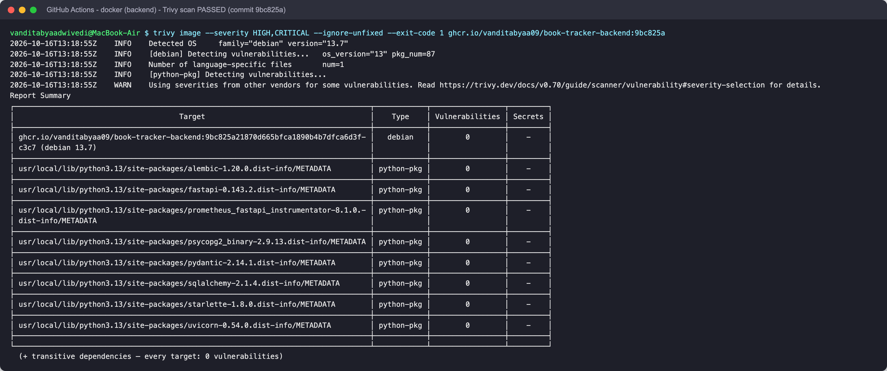 | 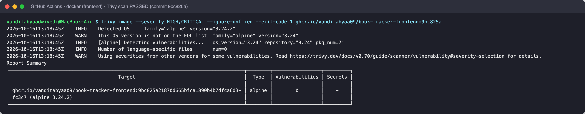 |

**Other security measures:** both containers run as non-root (and K8s enforces `runAsNonRoot: true`). No credentials
are committed (`terraform.tfvars`, `*.tfstate`, `.env` are git-ignored, and the commit history was scanned for `AKIA…`
keys). CI authenticates with the short-lived `GITHUB_TOKEN`, and the runtime requirements file contains only direct
dependencies (6 packages) to keep the attack surface small.

## 9. Infrastructure as Code: Terraform (AWS VPC + EKS)

All AWS infrastructure is created from [`terraform/`](terraform/). Nothing is clicked together in the console.

| File | Purpose |
|---|---|
| `versions.tf` | Terraform ≥ 1.5, AWS provider `~> 5.95`, default tags (`Project`, `ManagedBy=terraform`) |
| `variables.tf` | `region`, `project_name`, `cluster_version`, `node_instance_type` |
| `vpc.tf` | `terraform-aws-modules/vpc` |
| `eks.tf` | `terraform-aws-modules/eks` |
| `outputs.tf` | cluster name, VPC id, ready-to-run `aws eks update-kubeconfig` command |
| `terraform.tfvars.example` | template for your own `terraform.tfvars`. **No credentials, ever** |

**What gets created (54 resources, per `terraform plan`):**
- **VPC** `10.0.0.0/16` across **2 availability zones**
  - **2 public subnets** (`10.0.1.0/24`, `10.0.2.0/24`), tagged `kubernetes.io/role/elb` so AWS places internet-facing load balancers there
  - **2 private subnets** (`10.0.11.0/24`, `10.0.12.0/24`) for the worker nodes
  - Internet gateway, **one NAT gateway** (so private nodes can pull images), and route tables
- **EKS cluster** `book-tracker-eks`, Kubernetes **1.36**, public API endpoint, with the creating IAM identity granted cluster-admin
  through an EKS access entry
- **Managed node group:** **2 × `m7i-flex.large`** (2 vCPU, 8 GiB; min 2 / max 3), Amazon Linux 2023, one node per AZ. This size was chosen
  because EKS limits pods per node by instance size, and `t3.medium` (~17 pods) would overflow once monitoring and ArgoCD are added.

**Usage**
```bash
cd terraform
cp terraform.tfvars.example terraform.tfvars    # set cluster_version (aws eks describe-cluster-versions)
terraform init
terraform plan -out=tfplan
terraform apply tfplan                          # ~15–20 min
$(terraform output -raw configure_kubectl)      # point kubectl at the new cluster
kubectl get nodes
```

Credentials come from the AWS CLI profile (`~/.aws/credentials`) and are never stored in the repo. State is kept
locally and git-ignored.

**`terraform plan`:** 54 resources to add, 0 to change, 0 to destroy:

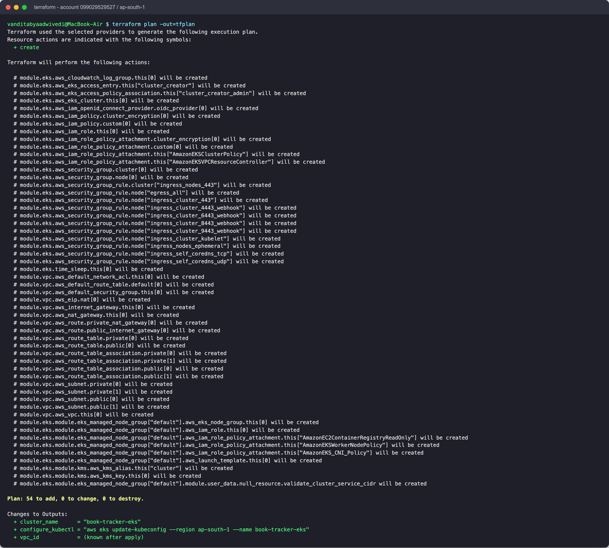

<details><summary>Plan excerpt: VPC, public/private subnet and NAT gateway attributes</summary>

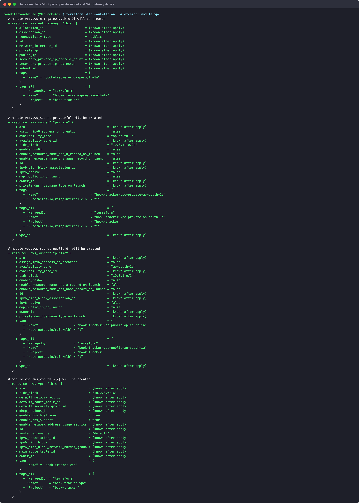
</details>

**`terraform apply`:**

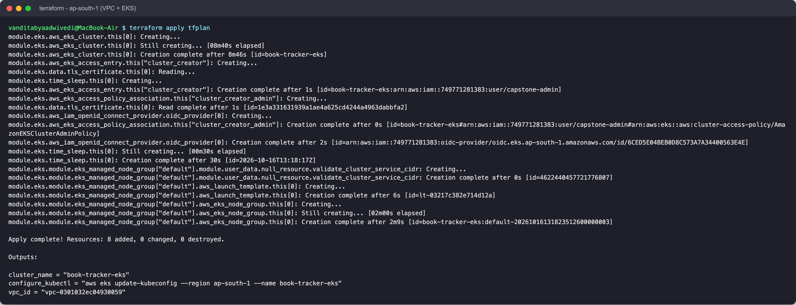

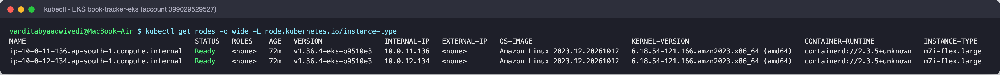

<!-- AWS Console evidence (add before submission):


-->

## 10. Kubernetes and Helm deployment

The app is packaged as a Helm chart in [`helm/book-tracker/`](helm/book-tracker/):

| Template | Resources |
|---|---|
| `secret.yaml` | `db-credentials` Secret (Postgres user/password/db + `DATABASE_URL`) |
| `postgres.yaml` | Postgres Deployment (`pg_isready` readiness probe) + ClusterIP Service `postgres` |
| `backend.yaml` | Deployment (**2 replicas**, `runAsNonRoot`, liveness/readiness on `/health`, CPU/memory requests and limits) + ClusterIP Service `backend:8000` (named port `http`) |
| `frontend.yaml` | Deployment (**2 replicas**, `runAsNonRoot`, probes on `/`) + ClusterIP Service `frontend:8080` |
| `ingress.yaml` | Ingress (class `nginx`): `/api` → `backend`, `/` → `frontend` |
| `servicemonitor.yaml` | Prometheus Operator `ServiceMonitor`, which scrapes `backend` port `http` on `/metrics` every 15 s |

Key values (`values.yaml`): `imageRegistry`, `imageTag` (a commit SHA written by CI), replica counts, Postgres
settings, `ingress.className/host`, `serviceMonitor.enabled`.

**Deploy steps (on any cluster):**
```bash
kubectl apply -f k8s/namespace.yaml

# Ingress controller (creates an AWS load balancer on EKS)
helm repo add ingress-nginx https://kubernetes.github.io/ingress-nginx
helm upgrade --install ingress-nginx ingress-nginx/ingress-nginx -n ingress-nginx --create-namespace

# Monitoring first, so the ServiceMonitor CRD exists (see §12)

# The application
helm upgrade --install book-tracker helm/book-tracker -n book-tracker
kubectl get pods,svc,ingress -n book-tracker
kubectl get svc -n ingress-nginx ingress-nginx-controller   # EXTERNAL-IP = public URL
```

**Running on EKS:** 2 backend + 2 frontend replicas spread across both nodes and AZs, all `Running`. The restart on each
backend pod happened while Postgres was still starting; the container exits if migrations can't connect, and
Kubernetes restarts it until the DB is ready.

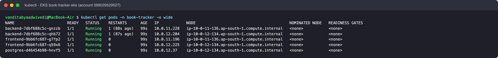

| `kubectl get svc` (ClusterIP Services) | `helm list` |
|---|---|
| 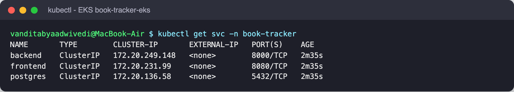 | 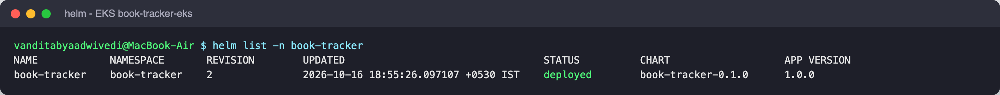 |

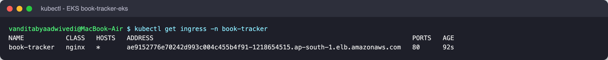

The screenshot at the top of this README shows the app served through this Ingress at the ELB hostname.

## 11. GitOps with ArgoCD

[`k8s/argocd-application.yaml`](k8s/argocd-application.yaml) points ArgoCD at `helm/book-tracker` on `main`, with
`automated: { prune: true, selfHeal: true }`.

```bash
kubectl create namespace argocd
kubectl apply -n argocd --server-side --force-conflicts \
  -f https://raw.githubusercontent.com/argoproj/argo-cd/stable/manifests/install.yaml
kubectl -n argocd get secret argocd-initial-admin-secret -o jsonpath="{.data.password}" | base64 -d; echo
kubectl port-forward -n argocd svc/argocd-server 8080:443        # https://localhost:8080 (admin)

helm uninstall book-tracker -n book-tracker      # hand the release over from Helm CLI to ArgoCD
kubectl apply -f k8s/argocd-application.yaml
```

**The GitOps loop:** CI never runs `kubectl` against the cluster. It only publishes an image and commits the new SHA to
Git. ArgoCD **pulls** the desired state from Git and continuously reconciles the cluster to match it. `selfHeal` reverts
manual drift (for example a `kubectl edit`), and `prune` removes resources deleted from the chart. Rolling back means
reverting a commit.

**ArgoCD v3.5.5 on EKS: `book-tracker` is Healthy and Synced** to `main` at the commit made by the pipeline's
`update-helm-values` job (`ci: deploy images 5c1d4d3 [skip ci]`). That is the GitOps loop working end to end, from a push
to CI, to a new image in GHCR, to the tag committed in Git, to ArgoCD rolling the cluster forward.

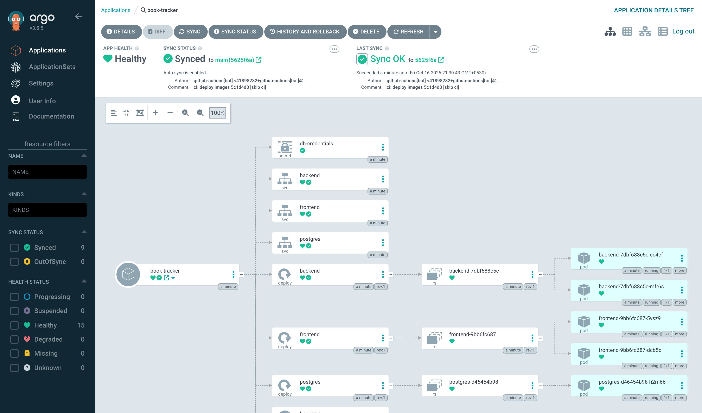

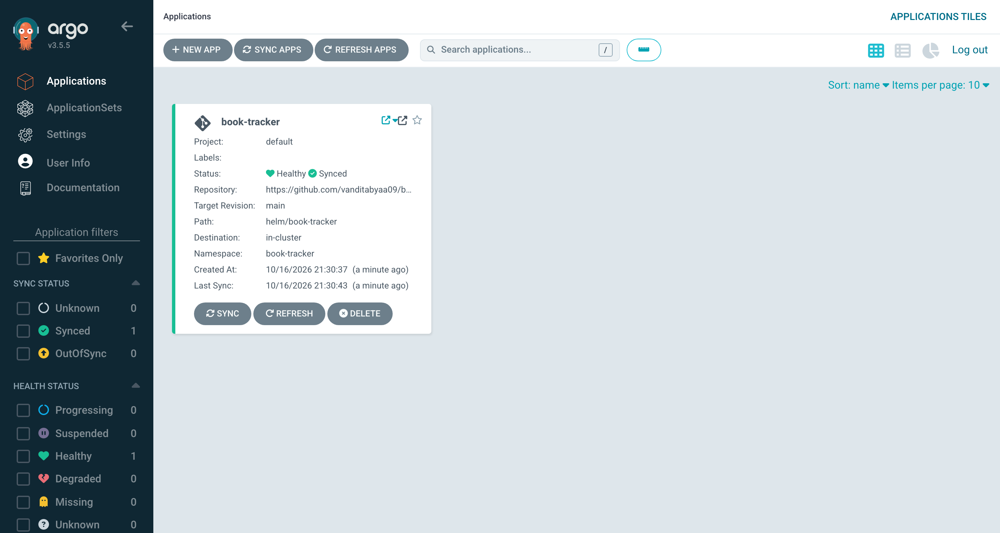

## 12. Observability: Prometheus and Grafana

**Metrics:** `prometheus-fastapi-instrumentator` exposes `/metrics` with `http_requests_total{handler,method,status}`
(counter) and `http_request_duration_seconds` (histogram).

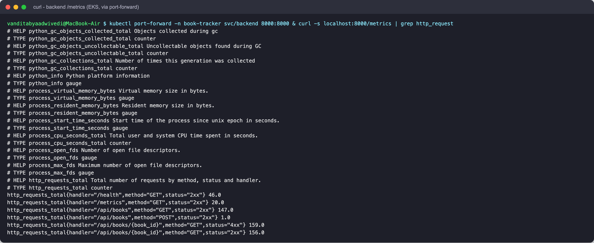

**Install** (`kube-prometheus-stack` = Prometheus Operator + Prometheus + Grafana + exporters):
```bash
helm repo add prometheus-community https://prometheus-community.github.io/helm-charts
helm upgrade --install monitoring prometheus-community/kube-prometheus-stack \
  -n monitoring --create-namespace \
  -f monitoring/prometheus-values.yaml -f monitoring/grafana-values.yaml
```
- [`monitoring/prometheus-values.yaml`](monitoring/prometheus-values.yaml) sets `serviceMonitorSelectorNilUsesHelmValues: false`, so
  Prometheus picks up ServiceMonitors from **any** namespace and release (otherwise it only sees ones labelled for its own release).
  It also sets 2-day retention and disables Alertmanager.
- [`monitoring/grafana-values.yaml`](monitoring/grafana-values.yaml) configures Grafana (ClusterIP, default dashboards). The admin password
  is generated by the chart and read from the `monitoring-grafana` Secret. It is never committed.

**Access:**
```bash
kubectl port-forward -n monitoring svc/monitoring-kube-prometheus-prometheus 9090:9090   # Prometheus
kubectl port-forward -n monitoring svc/monitoring-grafana 3001:80                        # Grafana (admin)
kubectl get secret -n monitoring monitoring-grafana -o jsonpath="{.data.admin-password}" | base64 -d
```

**Prometheus is scraping both backend replicas, and both are UP:**

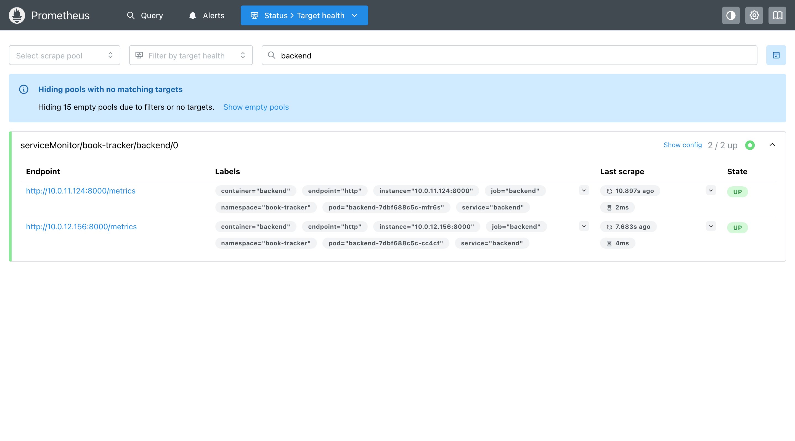

**Grafana dashboard** ([`monitoring/dashboards/book-tracker.json`](monitoring/dashboards/book-tracker.json); import it via
*Dashboards → Import*) shows the **RED** signals, **R**ate, **E**rrors and **D**uration:

| Panel | PromQL |
|---|---|
| Request rate | `sum(rate(http_requests_total{job="backend"}[1m]))` |
| p95 latency | `histogram_quantile(0.95, sum by (le) (rate(http_request_duration_seconds_bucket{job="backend"}[5m])))` |
| Error rate | `sum(rate(http_requests_total{job="backend",status=~"4..\|5.."}[5m])) / sum(rate(http_requests_total{job="backend"}[5m]))` |
| Requests by endpoint | `sum by (method, handler) (rate(http_requests_total{job="backend"}[1m]))` |
| Responses by status | `sum by (status) (rate(http_requests_total{job="backend"}[1m]))` |

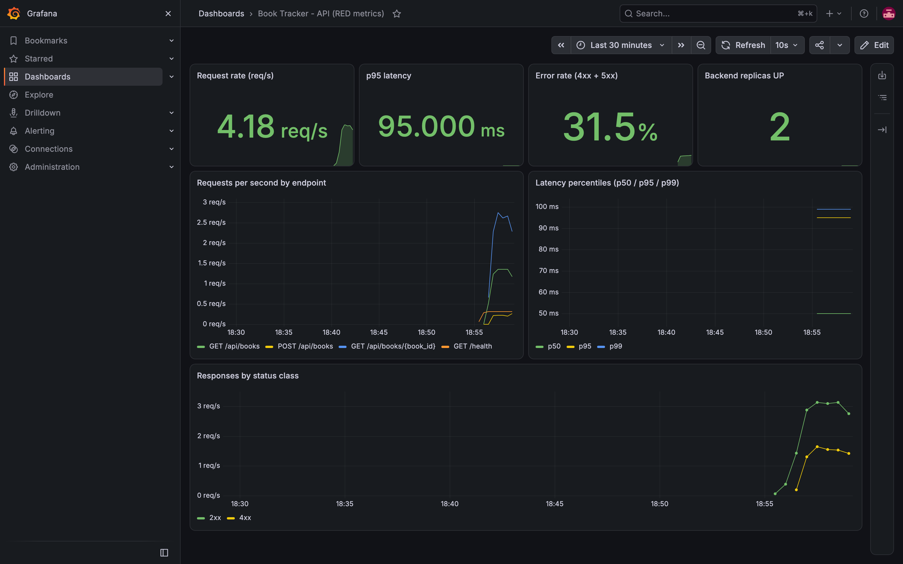

> The ~30% "error rate" in the screenshot is intentional. The load generator used for the demo mixes valid requests with
> requests for a non-existent book (`404`) and invalid payloads (`422`), so the error and status panels have data to show.

## 13. Teardown and cost control

EKS bills by the hour (control plane + 2 EC2 nodes + NAT gateway + ELB ≈ **$0.35/hour**). Load balancers created by
Kubernetes are **not** in Terraform state, so remove them first, or `terraform destroy` will fail on the VPC and leave
resources billing:

```bash
kubectl delete -f k8s/argocd-application.yaml --ignore-not-found
helm uninstall ingress-nginx -n ingress-nginx     # deletes the AWS ELB
helm uninstall monitoring -n monitoring
helm uninstall book-tracker -n book-tracker
kubectl delete namespace argocd book-tracker monitoring ingress-nginx --ignore-not-found
# confirm EC2 → Load Balancers is empty, then:
cd terraform && terraform destroy
```

**Teardown evidence:** after the ELB was removed (Helm uninstall + namespace deletion), `terraform destroy` removed
every remaining resource, and an audit of the region confirmed nothing billable was left.

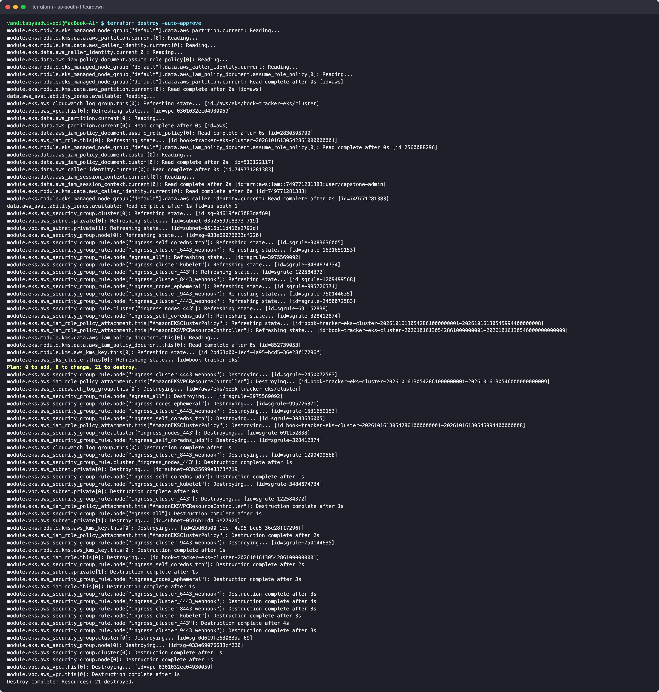

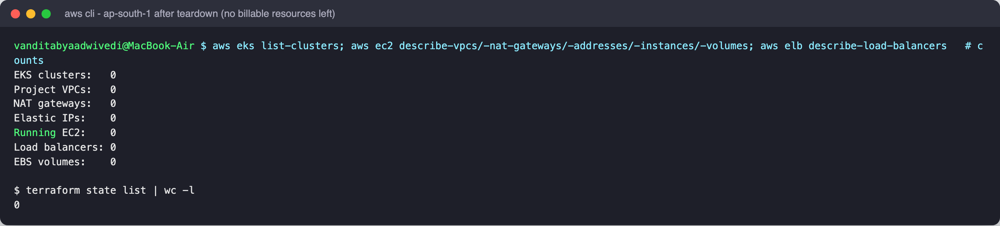

> A transient DNS failure on the workstation interrupted the first `destroy` run while it was waiting on the EKS
> cluster deletion. Because Terraform tracks progress in state, re-running `terraform destroy` simply removed the
> remaining 21 resources. This is the same idempotent behaviour that lets an interrupted `apply` be resumed.

## 14. Known issues and limitations

| Limitation | Production-grade alternative |
|---|---|
| PostgreSQL runs in-cluster with an `emptyDir` volume, so **data is lost if the pod restarts**. A plain EKS cluster has no EBS CSI driver, so a PVC would stay `Pending` | StatefulSet + PVC with the `aws-ebs-csi-driver` addon, or **Amazon RDS** |
| Demo DB password is in `values.yaml` (rendered into a K8s Secret) | External Secrets Operator + AWS Secrets Manager, or Sealed Secrets |
| Terraform state is local (git-ignored) | S3 backend with state locking |
| HTTP only, no TLS on the load balancer | cert-manager + Let's Encrypt, or an ACM certificate |
| The AWS account is on the **Free plan**, which only allows a short list of instance types. The first apply with `t3.large` hung because every `RunInstances` call was rejected (`not eligible for Free Tier`, visible in CloudTrail). Nodes now use Free-plan-eligible **`m7i-flex.large`** | A paid-plan account, which allows any instance type and Spot/Graviton node groups |
| Single NAT gateway (one AZ is a single point of failure for egress) | One NAT gateway per AZ |
| `AdministratorAccess` IAM user used for provisioning | Least-privilege IAM policy / role assumed via SSO or OIDC |
| ingress-nginx is in upstream retirement (still works) | Gateway API (e.g. AWS Load Balancer Controller / Envoy Gateway) |
| Backend runs migrations at startup in every replica, so concurrent first starts can race (resolved by restart) | Run migrations once as a Helm hook / Kubernetes Job |
| CI images are `linux/amd64` only (EKS nodes are x86); local Apple-Silicon minikube needs locally built images | Multi-arch builds (`platforms: linux/amd64,linux/arm64`) |
| Some GitHub actions still target Node 20 (deprecation warnings in CI) | Bump to the latest major versions of the official actions |

## 15. Screenshot index

| # | Evidence | Module |
|---|---|---|
| 01 | [App via EKS Ingress / ELB](docs/screenshots/01-app-eks-ingress.png) | M1, M8 |
| 02 | [Responsive mobile layout](docs/screenshots/02-app-mobile.png) | M1 |
| 03 | [`pytest -v` all passing](docs/screenshots/03-pytest-passing.png) | M2 |
| 04 | [Commit history](docs/screenshots/04-commit-history.png) | M3 |
| 05a–c | [`docker compose up --build`](docs/screenshots/05a-docker-compose-up.png) · [non-root](docs/screenshots/05b-docker-nonroot.png) · [localhost:3000](docs/screenshots/05c-app-localhost-3000.png) | M4 |
| 06 | [Green GitHub Actions run](docs/screenshots/06-github-actions-green.png) | M5 |
| 07a–c | [Trivy before fix](docs/screenshots/07a-trivy-before-fix-4-high.png) · [backend clean](docs/screenshots/07b-trivy-backend-clean.png) · [frontend clean](docs/screenshots/07c-trivy-frontend-clean.png) | M6 |
| 08–09 | [GHCR backend](docs/screenshots/08-ghcr-backend-package.png) · [GHCR frontend](docs/screenshots/09-ghcr-frontend-package.png) | M5 |
| 10 | [EKS nodes Ready](docs/screenshots/10-kubectl-get-nodes.png) | M7 |
| 11–14 | [pods](docs/screenshots/11-kubectl-get-pods.png) · [svc](docs/screenshots/12-kubectl-get-svc.png) · [ingress](docs/screenshots/13-kubectl-get-ingress.png) · [helm list](docs/screenshots/14-helm-list.png) | M8 |
| 15 | [`/metrics` output](docs/screenshots/15-metrics-endpoint.png) | M9 |
| 16 | [Prometheus targets UP](docs/screenshots/16-prometheus-targets.png) | M9 |
| 17 | [Grafana dashboard](docs/screenshots/17-grafana-dashboard.png) | M9 |
| 18 | [`terraform apply`](docs/screenshots/18-terraform-apply.png) | M7 |
| 21 | [ArgoCD Synced/Healthy](docs/screenshots/21-argocd-synced.png) · [applications](docs/screenshots/21b-argocd-applications.png) | GitOps (video) |
| 19a–b | [`terraform plan` summary](docs/screenshots/19a-terraform-plan-summary.png) · [VPC detail](docs/screenshots/19b-terraform-plan-vpc-detail.png) | M7 |
| 22 | [`terraform destroy` complete](docs/screenshots/22-terraform-destroy.png) | M7 |
| 23 | [AWS region clean after teardown](docs/screenshots/23-aws-clean-after-destroy.png) | M7 |
